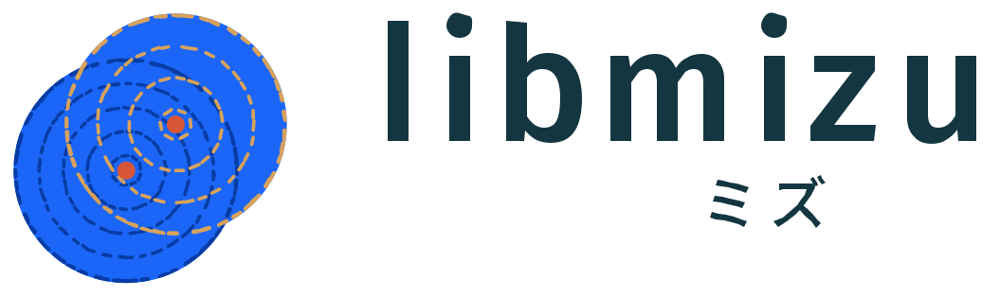

# libmizu

<a href="https://shikokuchuo.net/libmizu/"><picture><source media="(prefers-color-scheme: dark)" srcset="https://raw.githubusercontent.com/shikokuchuo/libmizu/main/docs/assets/logo-dark.svg"></picture></a>

[](https://github.com/shikokuchuo/libmizu/actions/workflows/ci.yml)
[](https://codecov.io/gh/shikokuchuo/libmizu)
[](LICENSE)
[](https://shikokuchuo.net/libmizu/)

Lock-free shared memory IPC at thread speed in C11.

libmizu is for runtimes that parallelize with processes rather than threads. A message round trip drops from tens of microseconds over sockets to < 1 µs, so you can divide work as finely as you would with threads (see [Performance](#performance)).

Channels and work-stealing task pools run over POSIX shared memory (Linux, macOS) or Win32 file mappings (Windows): lock-free single-producer single-consumer rings with batched publication, spin-then-park waiting that stays out of the kernel on the hot path, and OS notification when a peer dies.

Bindings share one wire format, so processes in different languages can exchange data over the same channel.
The first-party bindings are [mizu](https://github.com/shikokuchuo/mizu) for R and [pymizu](https://github.com/shikokuchuo/pymizu) for Python.
[Writing a binding](#writing-a-binding) covers other languages.

- Lock-free SPSC rings and work-stealing deques over shared memory
- Bounded, microsecond-latency waiting: futex, `__ulock`, or `WaitOnAddress` per platform
- Event-driven wakeups: edge-triggered notify endpoints signaled by the publisher; no polling threads
- Peer death detected by OS notification and confirmed by a kernel-released lock; no heartbeats or polling
- Crash-atomic claims (copy-then-CAS): a dead peer never leaves a queue stuck
- FFI-safe ABI: opaque handles, exported functions only, `mizu_status` sentinels on hot paths
- C11, 64-bit: Linux, macOS, and Windows

> **Lifecycle: experimental.** The API is not yet stable and we may make changes in response to feedback.

## Performance

Representative figures from the C bench suite (`make bench`), measured on an Apple M4 Pro (macOS, arm64).

| Benchmark | Best observed |
| --- | --- |
| Channel round trip (nil / 64 B payload) | 0.3–0.4 µs |
| Channel round trip (64 KiB, arena tier) | 4.0 µs |
| Channel round trip (1 MiB, spill tier) | 50 µs |
| Channel batch throughput (64 B, batches of 32) | 52.8 M msgs/s |
| Pool submit + collect (nil payload) | 0.4 µs |
| Pool submit + collect (4 KiB payload) | 1.0 µs |
| Pool task throughput (tiny echo tasks) | ~11 M tasks/s |

See [`bench/notes.md`](https://github.com/shikokuchuo/libmizu/blob/main/bench/notes.md) for the full dated records, including parker wake latency and spill-region costs.

## Quickstart

This example makes a channel between two processes with the built-in bytes binding.
The bytes binding needs no callbacks, so the example compiles as written.
The host:

```c
#include <mizu_ext.h>   /* mizu_binding_bytes, mizu_bytes (implies mizu.h) */

mizu_channel_opts opts;
mizu_channel_opts_init(&opts);
mizu_binding binding;
mizu_binding_bytes(&binding);

mizu_channel *ch;
mizu_channel_create(&ch, &opts, &binding);

char token[64];
mizu_channel_token(ch, token, sizeof token);
/* spawn the peer however you like, passing the token */
mizu_channel_ready_wait(ch, -1);                 /* block until attach */

mizu_bytes out = { "hello", 5 };                 /* { data, len } */
mizu_channel_send(ch, &out);

void *obj;
mizu_channel_recv(ch, &obj, -1);                 /* MIZU_OK / sentinels */
mizu_bytes *in = obj;                            /* in->data, in->len */
mizu_bytes_free(in);

mizu_channel_close(ch, 5000);                    /* up to 5 s for the peer's close */
mizu_channel_destroy(ch);
```

The peer fills its binding with `mizu_binding_bytes()` too and attaches with `mizu_channel_attach(&ch, token, &binding)`.
It reads the bootstrap payload with `mizu_channel_drop()` and signals `mizu_channel_ready_set()`.

To move a language's own objects rather than byte buffers, register callbacks on the binding.
This is the seam that [Writing a binding](#writing-a-binding) covers:

```c
mizu_binding binding;
mizu_binding_init(&binding);
binding.stage = my_stage;   /* frame your objects as (hdr, payload) */
binding.read  = my_read;    /* the receive-side materializer */
```

[`include/mizu.h`](include/mizu.h) documents the full contract for each declaration: ownership, threading, and the `mizu_status` values that each verb returns.
[`DESIGN.md`](DESIGN.md) gives the invariants.
The rendered API reference is at [shikokuchuo.net/libmizu](https://shikokuchuo.net/libmizu/).

## Writing a binding

A binding tells libmizu how to turn the language's values into frames and back.
The `stage` and `read` callbacks from the quickstart do the conversion, and `exec` runs tasks on pool workers.
libmizu does the rest: the rings, waiting and waking, peer-death detection, and work-stealing.
The built-in bytes binding, `mizu_binding_bytes()`, needs no callbacks and moves byte buffers, as the quickstart shows.

Every operation is an exported function.
A language with a foreign function interface can call libmizu from the shared library, with no C of its own.
Every handle is opaque, so libmizu's internals can change without breaking the binding.
Bindings that compile C can add the amalgamation to their own build instead, as described under [Building](#building).

## API tiers

The headers form two tiers:

- **`mizu.h`** — the consumer API, stable from 1.0.
  The soname tracks its ABI.
- **`mizu_ext.h`** — the binding-author API: the callback seam (`stage`, `read`, `exec`, ...), the stager/read/publish services, the built-in bytes binding, and promoted internals (parker, liveness, preamble, map support).
  It is pinned per minor release and can change without deprecation, so binding authors rebuild or re-vendor when they move to a new minor.

A third header, `src/internal.h`, is private. It is never installed, and bindings never include it.

## Building

libmizu needs a C11 compiler and a 64-bit platform: the wire formats depend on lock-free 64-bit atomics.
On Linux, kernel 5.3 or later is required (for `pidfd_open`).

The Makefile is the only build system:

```sh
make                    # libmizu.a + the shared library
make test               # the unit and ext tiers (in-process, deterministic)
make test-integration   # the integration tier (forked child processes)
make test-soak          # the soak tier (minutes-long contention runs; nightly)
make test-fuzz          # libFuzzer bursts on the wire parsers (clang)
make bench              # the benchmark suite (report-only)
make coverage           # llvm-cov report over the unit tier (report-only)
make tidy               # clang-tidy over the library sources (report-only;
                        # TIDY overrides the binary)
make docs               # doxygen API reference into docs/html
make install            # honors PREFIX (/usr/local) and DESTDIR;
                        # also installs libmizu.pc for pkg-config
```

On Windows, run `tools\build-win.bat` instead.
The script builds with clang-cl, since MSVC's C11 atomics are experimental, so it needs LLVM and the Visual Studio C++ build tools.
GitHub Windows runners have both preinstalled.

Static builds need no defines, because `MIZU_API` is empty by default.
That covers vendored and amalgamated builds, where the first-party packages compile the sources into their own modules.
If you build libmizu as a shared library, define `MIZU_SHARED`.
If you compile the library itself on Windows, also define `MIZU_BUILDING`.
The Makefile and `build-win.bat` set these defines for you.

To generate the amalgamation, run:

```sh
tools/amalgamate.sh   # writes mizu.c + mizu.h + mizu_ext.h
```

## Contributing

See [CONTRIBUTING.md](CONTRIBUTING.md) for the repository layout and contributor notes.

## License

MIT.
`LICENSE.note` has the third-party attributions (RngStreams jump matrices, vendored doxygen stylesheet).
